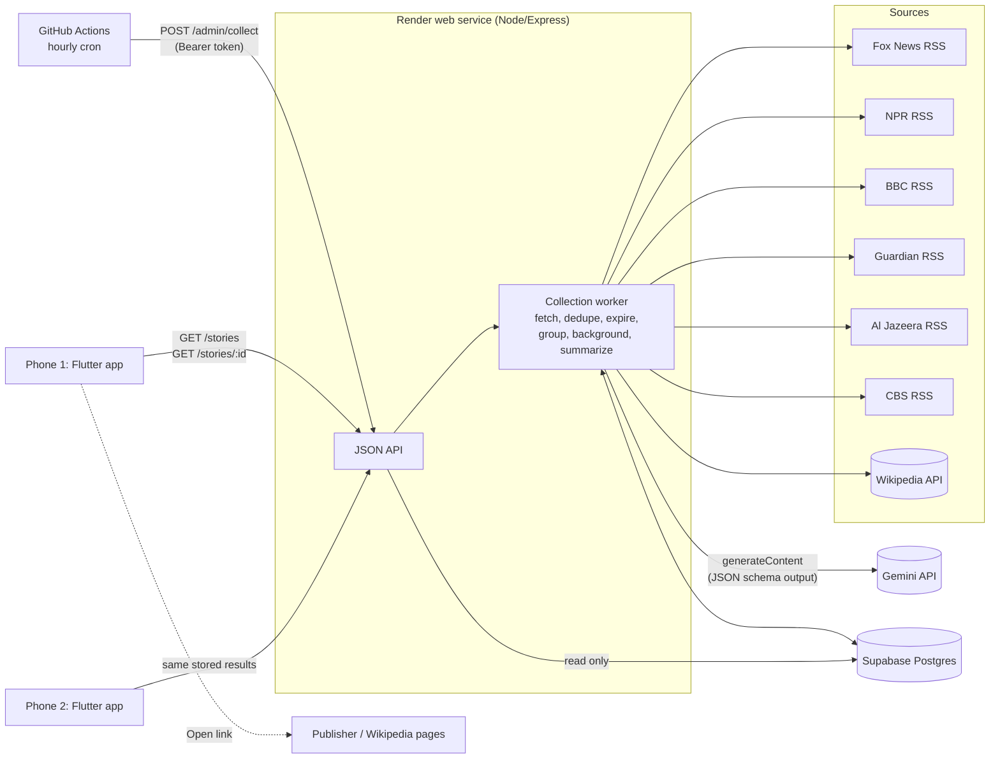

# My News: CS 403 AI-powered news service

My News collects coverage from six news publishers every hour, groups articles about the same event into one **story**, attaches relevant **background** links, and generates a labeled **AI overview and perspectives** for each story. A native **Flutter** app reads the stored results from the server. The app never fetches news, groups articles, or calls the AI model itself.

| | |
|---|---|
| **Deployed API** | https://mynews-api-l39l.onrender.com ([stories](https://mynews-api-l39l.onrender.com/stories) · [status](https://mynews-api-l39l.onrender.com/status)) |
| **Client** | Flutter app in [`app/`](app/), release APK built with `flutter build apk --release` |
| **Server** | Node.js 24 + Express 5 in [`server/`](server/) |
| **Database** | Postgres (Supabase free tier); embedded PGlite for local development and tests |
| **AI** | Google Gemini (`gemini-3.8-flash`, free tier), called only by the server's hourly worker |
| **Schedule** | GitHub Actions cron, hourly at :05 UTC ([workflow](.github/workflows/hourly-collect.yml)) |

Other documents: [verification evidence](docs/VERIFICATION.md) · [AI summary review](docs/AI_SUMMARY_REVIEW.md) · [AI development reflection](docs/AI_REFLECTION.md) · [release notes and defect log](docs/RELEASE_NOTES.md) · [demo checklist](docs/DEMO_CHECKLIST.md). The original browser-only starter is kept for reference in [`starter/`](starter/).

---

## Architecture



**How many readers reuse the same work:** each hourly run does all upstream work once (feed fetches, grouping, Wikipedia lookups, AI calls) and stores the results. Every client request is a database read. Two phones opening the same story get the same stored summary `version` and `generated_at`. The AI model is called again only when the set of articles behind a story changes (an article joins, changes, or expires) or the prompt version changes. `GET /status` shows `total_generations`, which does not change when clients read.

### Server / client boundary

| Action in the app | What happens |
|---|---|
| Launch, pull-to-refresh, Refresh button | `GET /stories`: reads the database |
| Tap a story | `GET /stories/{id}`: reads the database |
| AI analysis / perspective buttons | Display data already included in the story response; no network call |
| Publisher / background buttons | Open the original page in the phone's browser |

No API keys or secrets are in the Flutter build. The only build-time setting is the public API URL.

---

## Data model

Schema: [`server/migrations/001_init.sql`](server/migrations/001_init.sql). It is applied automatically at startup or with `npm run migrate`. All timestamps are `timestamptz` and are written in UTC; the app displays them in the phone's local time.

| Table | Purpose | Key fields |
|---|---|---|
| `publishers` | The six feeds (plus labeled fixture sources) | `id`, `name`, `feed_url`, `is_fixture` |
| `articles` | One publisher's report | `id` = sha256(publisher \| normalized URL), **unique (`publisher_id`, `url_normalized`)**, `title`, `excerpt` (feed text only), `published_at`, `first_seen_at`, `last_seen_at`, `content_hash`, `story_id` |
| `stories` | An event grouping one or more articles | stable `id` (`st_…`, never reused), `headline`, `created_at`, `updated_at`, `background_checked_at` |
| `background_resources` | Wikipedia pages | `url` (unique), `title`, `description`, `provider` |
| `story_background` | Links stories to resources | `story_id`, `resource_id`, `matched_term` |
| `summaries` | One stored AI analysis per story | `version`, `input_hash`, `article_ids`, `overview`, `agreement`, `disagreement`, `uncertainty`, `overview_refs`, `perspectives_status`, `perspectives` (each with `article_ids`), `model`, `prompt_version`, `generated_at`, `last_error`, `invalidated_reason` |
| `collection_runs` | Job log | `trigger`, `started_at`, `finished_at`, `outcome` (success/partial/failed), per-feed results, article/story/summary counts, `error` |

Deleting a story cascades to its summary and background links. Job logs contain only counts and errors, never article text or summaries, so they may outlive the seven-day window.

---

## API

Base URL: the deployed service. All responses are JSON with `Cache-Control: no-store`.

### `GET /stories`
Top stories from the last 168 hours. **Ordering ("top stories"):** newest first by latest article publication time, where each additional publisher counts as 6 hours newer. Widely covered events stay near the top without burying breaking single-source news.
```json
{
  "generated_at": "2026-10-19T14:02:11.000Z",
  "ordering": "newest first, boosted 6 hours per additional publisher",
  "retention_hours": 168,
  "collection": {
    "last_successful_at": "2026-10-19T14:01:40.000Z",
    "last_run": { "id": 31, "trigger": "schedule", "outcome": "partial", "feeds": [{ "publisher": "npr", "ok": false, "error": "HTTP 503" }], "articles": { "fetched": 158, "new": 6 }, "summaries": { "generated": 5, "failed": 0 } }
  },
  "stories": [
    { "id": "st_3f1c…", "headline": "4 dead, dozens injured after fire at Canadian military base",
      "latest_article_at": "2026-10-19T13:20:00.000Z", "updated_at": "…",
      "article_count": 4, "publisher_count": 4, "publishers": ["Al Jazeera", "BBC News", "CBS News", "The Guardian"],
      "summary_status": "current", "is_fixture": false }
  ]
}
```

### `GET /stories/{id}`
Complete story detail. Returns `404` with a readable `message` if the story does not exist or all of its articles have expired.
```json
{
  "id": "st_3f1c…", "headline": "…", "created_at": "…", "updated_at": "…", "latest_article_at": "…",
  "publisher_count": 4,
  "publishers": [{ "id": "bbc", "name": "BBC News", "articles": ["a1b2…"] }],
  "articles": [{ "id": "a1b2…", "publisher_id": "bbc", "publisher_name": "BBC News", "title": "…", "url": "https://www.bbc.com/news/…",
                 "published_at": "…", "excerpt": "…", "excerpt_note": "Feed excerpt as published by the source" }],
  "background": [{ "title": "Wikipedia: Alberta", "url": "https://en.wikipedia.org/wiki/…", "description": "…", "provider": "wikipedia", "matched_term": "…" }],
  "summary": {
    "status": "current", "message": null, "label": "AI-generated",
    "version": 2, "generated_at": "…", "model": "gemini-3.8-flash", "prompt_version": "2026-10-19.1",
    "input_scope": "feed_excerpts", "input_scope_note": "Generated from RSS feed excerpts only, not full articles. …",
    "input_article_ids": ["a1b2…", "…"],
    "overview": "…", "agreement": "…", "disagreement": "…", "uncertainty": "…",
    "overview_article_ids": ["a1b2…"],
    "perspectives_status": "supported", "perspectives_message": null,
    "perspectives": [{ "label": "Military officials", "summary": "…", "evidence_limits": "…", "article_ids": ["…"] }],
    "last_attempt_at": "…", "last_error": null
  }
}
```
`summary.status` is one of:

| status | Meaning | Text served? |
|---|---|---|
| `current` | Built from exactly the story's current articles | yes |
| `stale` | Newer articles joined since generation (all inputs still valid); `message` says how many | yes, with a notice |
| `outdated` | An article it used has expired; waiting for the next run to rebuild | **no** |
| `failed` | Generation failed (AI unavailable, refusal, bad output); `last_error` explains | no |
| `pending` | Not generated yet | no |

### `GET /status`
Operational view: AI configuration, totals (`active_articles`, `stories`, `stored_summaries`, `total_generations`), last successful collection, and the last 48 runs with start/finish time, outcome, per-feed results, and counts. Use it as evidence of hourly runs.

### `POST /admin/collect`
Starts a collection run. Requires `Authorization: Bearer $ADMIN_TOKEN` (otherwise `401`). Returns `202`; add `?wait=1` to wait for the result. Used by the hourly scheduler and for instructor demonstrations. If a run is already in progress it is skipped.

### `GET /healthz`
Liveness check.

---

## Collection, duplicates, and retention

Each hourly run ([`server/src/pipeline.js`](server/src/pipeline.js)) does the following:

1. **Fetch** all six feeds in parallel (15 s timeout each). A failed feed is recorded in `feed_results` and the run continues.
2. **Normalize and dedupe.** Each article URL is normalized: https, lowercase host without `www.`, no fragment, no tracking parameters (`utm_*`, `cmpid`, …), sorted query, no trailing slash. The article id is `sha256(publisher | normalized URL)`, and the database enforces `UNIQUE (publisher_id, url_normalized)`. Re-fetching updates `last_seen_at`. If the title or excerpt changed, the row is updated in place and `content_hash` changes, which triggers a summary rebuild.
3. **Expire** ([`server/src/retention.js`](server/src/retention.js)). Articles whose **publication time** is older than 168 hours are removed:
   - First, any summary that used one of them has its content cleared and is marked `invalidated_reason = 'supporting article expired'`. A summary that depends on removed material is never served.
   - Then the articles are deleted, stories with no remaining articles are deleted (cascading to summaries and background links), and background resources no longer linked to any story are deleted.
   - Between runs, the API also filters every query with `published_at >= now() - 168h`. Articles that cross the boundary disappear from responses immediately, and a summary that used them is reported as `outdated` with its text withheld.
4. **Group** new articles into stories (below).
5. **Background:** Wikipedia lookups for new or changed stories.
6. **Summaries:** generate where the input hash changed (up to `MAX_SUMMARIES_PER_RUN`, multi-publisher stories first, one at a time).
7. **Log** the run in `collection_runs`.

**Missing or invalid publication dates.** Retention depends on publication time, so an item without a parseable date, or with a date more than 60 minutes in the future, is **skipped and never stored**. It is counted in `articles_skipped`. Items already older than 168 hours at fetch time are skipped the same way. All six current feeds supply valid dates; the skip count is visible in every run record.

---

## Grouping method

Code: [`server/src/grouping.js`](server/src/grouping.js). The method is deterministic, explainable, and makes no AI call.

1. **Text vector:** TF-IDF over the title (counted twice) and feed excerpt, after lowercasing, removing stop words, and light plural stemming. IDF is computed over all articles currently in the window.
2. **Named entities:** runs of capitalized words ("Benjamin Netanyahu", "World Food Programme", "Gaza"), with titles and roles trimmed ("President", "Mr"). Two refinements avoid false names:
   - A capitalized word at the start of a sentence or quotation counts only if it is also capitalized mid-sentence, or is capitalized repeatedly and never lowercase. This rules out "Satellite photos show…" and "'Deeply appalled'…".
   - Title-Case headlines (common at US outlets) are ignored for entity extraction, because every word is capitalized.

   Nested names are collapsed, so "Netanyahu" inside "Benjamin Netanyahu" counts once. Two entities match when one's words are contained in the other's ("Trump" ~ "Donald Trump").
3. **Join rule:** a new article joins an existing story if, against at least one member published within **72 hours**:
   - cosine ≥ **0.36** and ≥ 1 shared entity, **or**
   - cosine ≥ **0.25** and ≥ **2** shared entities.

   **Matching one keyword or one person is never enough by itself.** For example, "Governor Maria Lopez signs budget" and "Governor Maria Lopez hospitalized after crash" share one entity at cosine 0.28, so they stay separate.
4. Otherwise the article starts a new story. Single-source stories are kept and labeled "1 publisher".
5. **Stability:** existing assignments are never reshuffled. New coverage joins the existing story id (no duplicate entry in the list), and story ids stay the same while their articles change. The headline is recomputed as the most representative member title: the one with the highest average similarity to the others.
6. Fixture (demo) articles are grouped only with each other, never with live news.

**Tuning and evidence.** Thresholds were tuned on a live sample of 159 articles from the six feeds on 2026-10-19. The first version merged unrelated stories that shared one prominent person or country, for example "Trump endorses Netanyahu" with "Israel's opposition is hawkish on Iran", and an NPR midterms roundup that mentioned Macron with French protest coverage. Collapsing nested entities and raising the weak threshold from 0.20 to 0.25 removed those merges. The final sample produced 9 multi-publisher stories with no false merges found by manual inspection. See [verification](docs/VERIFICATION.md) for the groups.

**Where it can go wrong:**
- **Missed merges (split stories)** when outlets describe the same event with different vocabulary and few shared names. Example: one outlet's headline names the country ("Canada military base") while another names only the base or region. If they share no entity and their cosine is below 0.36, they become two stories.
- **Wrong merges for ongoing situations** with many related events in the same place within 72 hours. Several separate West Bank settler-attack incidents in one week can chain into one story, because each shares "West Bank" plus an "Israeli…" entity with the next.
- **Live blogs and roundups** ("Monday briefing", "US politics live") cover several events, so they can join whichever story they resemble most.
- Short or empty feed excerpts give the algorithm less to work with.

The fixture dataset [`server/fixtures/grouping-cases.json`](server/fixtures/grouping-cases.json) (fictional, labeled, from "Fixture Source A/B/C") encodes 5 same-event groups and 2 related-but-separate cases. The automated test `test/grouping.test.js` checks both.

---

## Background resources

Code: [`server/src/background.js`](server/src/background.js).

1. Candidate terms are the named entities mentioned by **2+ articles** in the story, or those in the headline. Very generic ones ("US", "Trump", "government") are skipped. Terms are ranked by how many articles mention them, with multi-word names first. Up to 4 are tried.
2. Each term runs one Wikipedia API query (top search hit plus description, canonical URL, and disambiguation flag).
3. A hit is accepted only if **its title matches the term** (every word of the term is in the page title, or vice versa) and it is **not a disambiguation page**. At most 2 resources are kept per story.
4. If nothing passes, the story has no background, and the app shows **"No background resource available"** instead of a loosely related link.

Lookups are throttled (400 ms apart), stop early on HTTP 429, and run only for new or changed stories. The User-Agent includes `CONTACT_EMAIL`, as Wikipedia requires.

---

## AI summaries and perspectives

- **Prompt and model configuration:** [`server/src/ai/prompts.js`](server/src/ai/prompts.js) (`PROMPT_VERSION`, `MODEL_CONFIG`, `SYSTEM_PROMPT`). The call is in [`server/src/ai/summarize.js`](server/src/ai/summarize.js).
- **Model:** Google `gemini-3.8-flash` through the `@google/genai` SDK (`models.generateContent`), temperature 0.2, up to 8,192 output tokens. The request sets `responseMimeType: "application/json"` and a `responseJsonSchema` generated from a Zod schema, and the server validates the reply against the same schema before storing it. Each stored result has `overview`, `agreement`, `disagreement`, `uncertainty`, `overview_refs`, `perspectives_status`, and `perspectives[{label, summary, evidence_limits, supporting_article_refs}]`. Change the model with `GEMINI_MODEL`. AI calls run one at a time, 6 seconds apart (`AI_REQUEST_GAP_MS`), to stay inside the free tier's per-minute limit.
- **Grounding and traceability:** articles are sent as `<article id="A1" publisher=… published=…>` blocks with escaped content. The model cites ids; the server maps them back to article ids and **drops any reference that is not an input article**. Every perspective must cite at least one article. The app shows numbered supporting articles with Open buttons, an **AI-generated** label, the generation time, the model, and the input-scope disclosure ("feed excerpts only").
- **No invented opposition:** the prompt forbids assigning viewpoints from a publisher's reputation and requires `insufficient_evidence` when fewer than two viewpoints are actually reported. The server enforces this too: fewer than two supported perspectives means status `insufficient_evidence`, and the app shows "Insufficient evidence for distinct perspectives."
- **Prompt injection:** the system prompt states that article text is untrusted data, and the content is XML-escaped.
- **Reuse:** a summary is stored with an `input_hash` = sha256(prompt version + sorted article id:content hash). It is regenerated only when that hash changes. Reads never call the model.
- **Failures:** API errors, blocked prompts (`promptFeedback.blockReason`), truncated output (`MAX_TOKENS`), invalid JSON, and schema mismatches all produce `last_error` and an honest `failed` (or `stale`) status. No fallback text is ever presented as AI output. If the key is missing or rejected, or the free-tier rate limit is hit (HTTP 429), the run stops making AI calls; the remaining stories are summarized on the next hourly run.

Manual review of three generated summaries: [docs/AI_SUMMARY_REVIEW.md](docs/AI_SUMMARY_REVIEW.md).

---

## Flutter app

Code: [`app/lib/`](app/lib/). Screens follow the assignment's Appendix A flow:

1. **Top stories** ([`story_list_screen.dart`](app/lib/screens/story_list_screen.dart)): ordered as described under `GET /stories`; each entry shows the headline, "N publishers | Today, 9:40 AM", publisher names, last update time, warnings for failed sources or old data, Refresh button and pull-to-refresh, and loading / empty / error states with Retry.
2. **Story detail** ([`story_detail_screen.dart`](app/lib/screens/story_detail_screen.dart)): overview, then separate **Original coverage** (one button per publisher that covered it), **Background**, and **AI analysis** groups. The overview is the AI overview (labeled) when one is available; otherwise it shows a publisher's feed excerpt in quotation marks, labeled as original wording.
3. **Publisher chooser** ([`publisher_articles_screen.dart`](app/lib/screens/publisher_articles_screen.dart)): shown when one publisher has several articles in the story.
4. **AI analysis** ([`ai_analysis_screen.dart`](app/lib/screens/ai_analysis_screen.dart)): overview, agreement, differences, uncertainty, perspective buttons, numbered supporting articles, and status notices.
5. **Perspective** ([`perspective_screen.dart`](app/lib/screens/perspective_screen.dart)): attributed viewpoint, evidence and limits, supporting coverage, and Switch buttons.

**Offline cache** ([`api.dart`](app/lib/api.dart)): every successful response is saved with its sync time. If the server can't be reached, the app shows the saved copy under an **"Offline mode: showing saved copy from …"** banner with Retry. Cached data is re-filtered on display: stories and articles older than 168 hours are hidden, and a cached summary that used an expired article is withheld. Publisher and background pages always need a connection; the app says so if a page can't open.

### Build and run

```bash
cd app
flutter pub get
flutter test
# Release APK against the deployed server:
flutter build apk --release --dart-define=API_BASE_URL=https://mynews-api-l39l.onrender.com
# Output: app/build/app/outputs/flutter-apk/app-release.apk
# Install on a USB-connected phone (USB debugging enabled):
flutter install --release
```
Optional: add `--dart-define=FEEDBACK_URL=<issues or form link>` to set the About → "Report a problem" link. Without `API_BASE_URL`, the app targets `http://10.0.2.2:8080` (Android emulator → local server; plain http is allowed only in debug builds).

---

## Local development (server)

```bash
cd server
npm install
cp .env.example .env        # add GEMINI_API_KEY and CONTACT_EMAIL; leave DATABASE_URL empty for local PGlite
npm test                    # 12 tests: grouping fixtures + pipeline/API against in-memory Postgres
npm run collect             # one real collection run against the live feeds
npm start                   # API on http://localhost:8080
npm run load-fixtures       # optional: load the labeled fixture dataset (show it with INCLUDE_FIXTURES=true)
```

## Deployment

1. **Database (Supabase, free):** create a project, then copy *Project Settings → Database → Connection string → Session pooler* (IPv4). The schema is created automatically on first start.
2. **API (Render, free):** push this repository to GitHub, then in Render choose *New → Blueprint* and select the repo (it reads [`render.yaml`](render.yaml)). Enter `DATABASE_URL`, `GEMINI_API_KEY` (free from aistudio.google.com/apikey), `ADMIN_TOKEN` (`openssl rand -hex 24`), and `CONTACT_EMAIL`. Check `https://<service>.onrender.com/healthz`.
3. **Hourly schedule (GitHub Actions):** in the repo, open *Settings → Secrets and variables → Actions* and add `MYNEWS_API_URL` and `MYNEWS_ADMIN_TOKEN`. The workflow runs at :05 every hour. It wakes the server, starts a run, waits for it to finish, and fails visibly if the run fails. Trigger it manually with *Actions → Hourly news collection → Run workflow*.
   - Alternatives: the commented Render Cron Job in `render.yaml` (paid), or `ENABLE_INTERNAL_SCHEDULER=true` on an always-on host.
4. **First data:** run the workflow once manually, then open `/status` and `/stories`.
5. **App:** build the APK with the deployed URL (above).

## Service choices and expected costs

| Service | Choice | Cost / quota |
|---|---|---|
| Hosting | Render web service (free) | 750 instance-hours/month; **sleeps after 15 min idle**, so the first request after idle can take ~30–60 s (the app waits up to 60 s and shows a hint). Render Starter ($7/month) removes sleep. |
| Database | Supabase Postgres (free) | 500 MB; this app uses a few MB (about 1,000 articles in the window). Free projects pause after a week with no activity; the hourly job keeps it active. |
| Scheduler | GitHub Actions | Free for public repos. Private repos: about 1–2 billed minutes per run × 720 runs/month, within the 2,000 free minutes. |
| AI | Google Gemini API, free tier (`gemini-3.8-flash`) | **$0.** The free tier has per-minute and per-day request limits (shown in Google AI Studio). The server makes at most 15 calls per hourly run (`MAX_SUMMARIES_PER_RUN`), spaced 6 s apart, and only for stories whose articles changed. On the free tier, Google may use prompts and responses to improve its products; the inputs here are public news excerpts. |
| Background | Wikipedia API | Free; throttled; needs a contact in the User-Agent. |
| Feeds | Publishers' public RSS | Free; excerpts only. |

## Known limitations

- Summaries use **RSS excerpts only** (one to three sentences per article), so the AI cannot see full reporting. This is disclosed on every AI screen.
- Grouping is lexical. See [Where it can go wrong](#grouping-method).
- Feed coverage is international/US general news. Some publisher feeds (e.g. CBS) include video segment titles ("Face The Nation") that form single-source stories.
- Free-tier cold starts delay the first request after idle.
- GitHub may delay scheduled workflows by several minutes at busy times, so runs are roughly, not exactly, hourly.
- Only English-language sources; publication times rely on what the feeds report.

Release notes, known minor issues, how beta testers report problems, and the defect log: [docs/RELEASE_NOTES.md](docs/RELEASE_NOTES.md).
